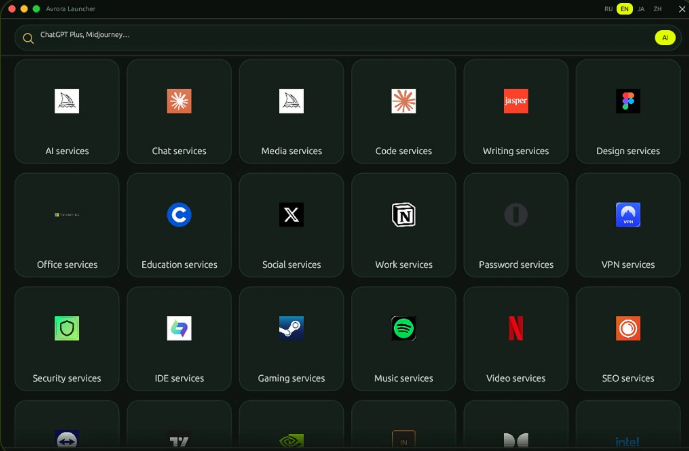

# NordPass Premium Free 2026 — XChaCha20 vault on Windows

> **NordPass is paid everywhere. In our Aivora launcher the same paid Premium version is free.**
>
> Official site / app store = paid Premium subscription. Aivora launcher = that paid Premium product, free on Windows 10 / 11.

**Keywords:** NordPass Premium · NordPass free · NordPass Windows 10 11 · XChaCha20 vault · breach scanner · paid NordPass free through launcher · Aivora Programs

Windows 10 / 11 · NordPass Premium · Passwords and Proton

Orange control → aivoraprograms.com → launcher → **Activate** **NordPass Premium**. You get the **paid Premium** vault **for free in our launcher**. This git tree is not `NordPassSetup.exe`.

## What NordPass Premium is

NordPass is Nord Security’s password manager. **Premium** on the Aivora card is the paid vault: **XChaCha20** encryption, unlimited items, **data breach scanner**, passkeys, secure sharing, emergency access, offline web vault. This is not NordVPN and not NordLocker.

XChaCha20 is the reason this page is not a Bitwarden or Enpass copy. Nord stores the vault with that cipher; the breach scanner watches emails you save. Passkeys are the modern login extra. Sharing and emergency access are Premium family/work extras.

**NordPass Premium is paid everywhere else.** Official Premium is a subscription. In **our Aivora launcher** that same paid Premium is **free** on Windows 10 / 11. No Nord account. No card.

## XChaCha20 and the breach scanner

XChaCha20 is the vault cipher, not a VPN protocol. The breach scanner is a watch on saved emails — it is not a full dark-web agency. Passkeys live next to passwords in the same Windows app after **Activate**. Emergency access is for a trusted person if you cannot open the vault; it is not a backdoor we document here.

## Who this Windows page is for

Searches: **NordPass Premium**, **NordPass Windows**, **NordPass free**, wanting the **paid Premium** vault, not the free item cap. Typical cases: a NordVPN household that wants the same vendor’s vault, passkeys on Windows, a breach ping on saved mail.

VPN is a different section. Calendar is Proton. This landing stays on NordPass Premium.

## What the Premium card includes

| Feature | Official NordPass | In our Aivora launcher |
|---------|-------------------|------------------------|
| Price | Paid Premium subscription | **Free** (same paid Premium) |
| XChaCha20 vault | Premium | Same Premium, free here |
| Data breach scanner | Premium | Same Premium, free here |
| Passkeys | Premium | Same Premium, free here |
| Secure sharing | Premium | Same Premium, free here |

## How to open paid NordPass Premium on Windows

1. Go to [https://aivoraprograms.com/](https://aivoraprograms.com/)
2. Get **Aivora Launcher**
3. Install on Windows 10 or Windows 11 (64-bit)
4. Open **Passwords and Proton**
5. Choose **NordPass Premium** → **Activate**

Paid NordPass Premium — **free in our launcher**, paid on nordpass.com.

## Queries

- NordPass Premium
- NordPass free
- NordPass Windows 10
- NordPass Windows 11
- XChaCha20 vault
- paid NordPass free through launcher

## Pictures

Launcher hub — **Passwords and Proton** → **NordPass Premium**:

## Questions

**Download?**  
[https://aivoraprograms.com/](https://aivoraprograms.com/)

**Paid or free?**  
Paid everywhere (official Premium). **Free in our Aivora launcher** — same paid Premium, not the free item limit.

**Nord account needed?**  
No. **Activate** on the tile.

---

## Русская версия

# NordPass Premium бесплатно 2026 — хранилище XChaCha20 на Windows

> **Везде NordPass платный. В нашем лаунчере Aivora та же платная версия Premium — бесплатно.**
>
> Официальный сайт / магазин = платная подписка Premium. Лаунчер Aivora = этот же платный Premium, бесплатно на Windows 10 / 11.

**Ключевые слова:** NordPass Premium · NordPass бесплатно · NordPass Windows 10 11 · XChaCha20 · сканер утечек · платный NordPass бесплатно через лаунчер · Aivora Programs

Оранжевый контрол — главная Aivora. Лаунчер → **Пароли и Proton** → **NordPass Premium** → **Активировать**. Это **платный Premium**, у нас в лаунчере **бесплатно**.

NordPass — менеджер паролей Nord Security. На карточке Aivora **Premium**: **XChaCha20**, безлимит записей, **сканер утечек**, passkeys, шаринг, emergency access. Это не NordVPN.

**NordPass Premium везде платный.** Официально подписка. **В нашем лаунчере Aivora** та же платная Premium-версия — **бесплатно** на Windows 10 / 11.

Как открыть: [https://aivoraprograms.com/](https://aivoraprograms.com/) → лаунчер → **Пароли и Proton** → **NordPass Premium** → **Активировать**.

NordPass — товарный знак Nord Security. Страница описывает доступ через Aivora Programs.

[https://aivoraprograms.com](https://aivoraprograms.com/) · hello@aivora.app

#windows11 #windows10 #passwords #nordpass #aivora

---

*NordPass Premium · NordPass free · paid NordPass free through launcher · XChaCha20 · Aivora Programs · https://aivoraprograms.com/programs/nordpass-premium/*
